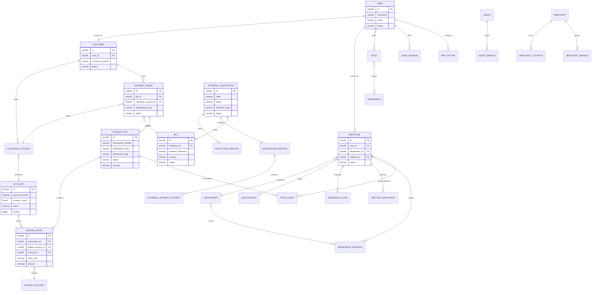

# Modelo Entidad-Relación actualizado

Este modelo distingue claramente entre las identidades, las relaciones laborales, las aplicaciones de trabajo y las operaciones financieras.

## Separación de responsabilidades

- **Usuario**: identidad de acceso y sesiones.
- **Empleado**: vínculo laboral de un usuario.
- **Departamento y cargo**: ubicación organizativa del empleado.
- **Rol y permiso**: autorizaciones independientes del cargo.
- **Workspace**: módulo de interfaz y operación diaria.
- **Core**: cuentas, operaciones financieras y contabilidad.
- **Connect**: instituciones, adaptadores y pagos externos.

## Diagrama principal

## Entidades principales

### Identidad y organización

- `users`
- `user_sessions`
- `mfa_factors`
- `customers`
- `employees`
- `departments`
- `job_positions`
- `roles`
- `permissions`
- `user_roles`
- `role_permissions`

Cada empleado pertenece a un departamento y ocupa un cargo, pero recibe autorización mediante roles y permisos independientes. Una secretaria podrá gestionar agenda y documentos sin heredar autorizaciones financieras.

### Clientes y cuentas

- `accounts`
- `customer_accounts`
- `account_holders` si la cuenta admite múltiples titulares
- `account_balance_snapshots`
- `account_status_history`

El saldo no se modifica directamente desde interfaces administrativas. Se concilia mediante `ledger_entries` y snapshots versionados.

### Operaciones financieras

- `transactions`
- `transaction_events`
- `ledger_accounts`
- `ledger_entries`
- `deposits`
- `withdrawals`
- `transfers`
- `payments`
- `commissions`

Toda operación tendrá:

- Identificador interno UUID.
- Número público único.
- Clave de idempotencia única.
- Estado controlado por una máquina de estados.
- Timestamp de creación y confirmación.
- Referencia opcional a la operación original que fue revertida.

### Instituciones y facturas

- `external_institutions`
- `institution_services`
- `integration_adapters`
- `bills`
- `payment_orders`
- `external_payment_attempts`
- `integration_webhooks`
- `reconciliation_runs`
- `reconciliation_items`

Cada institución puede tener varios servicios y adaptadores. El núcleo financiero no depende de una API externa concreta.

### Agentes, comercios y tarjetas

- `agents`
- `agent_branches`
- `agent_assignments`
- `merchants`
- `merchant_locations`
- `merchant_services`
- `merchant_settlement_accounts`
- `virtual_card_providers`
- `virtual_cards`

### Workspace

- `workspace_tasks`
- `workspace_requests`
- `workspace_approval_steps`
- `meetings`
- `meeting_participants`
- `workspace_documents`
- `document_permissions`
- `internal_messages`
- `message_recipients`
- `workspace_notifications`

Estas entidades pertenecen al módulo de operación diaria. No otorgan permisos financieros por sí mismas.

### Riesgos, cumplimiento y auditoría

- `risk_alerts`
- `risk_alert_actions`
- `compliance_cases`
- `audit_events`
- `notifications`
- `notification_outbox`
- `notification_dispatch_attempts`

## Convenciones

- UUID: `CHAR(36)`.
- Importes: `DECIMAL(20,4)`.
- Moneda: `CHAR(3)` siguiendo ISO 4217.
- Timestamps: `TIMESTAMP(6)` en UTC.
- Confirmaciones externas: conservar payload y respuesta sanitizada.
- Operaciones financieras: append-only.
- Correcciones: registrar una operación compensatoria, nunca borrar o modificar el original.
- Asientos contables: una transacción confirmada debe tener débitos y créditos equilibrados.
- Eliminaciones físicas: solo para borradores, datos temporales o entidades sin actividad financiera.

## Estados iniciales

- Usuario: `ACTIVE`, `LOCKED`, `DISABLED`.
- Empleado: `ACTIVE`, `LEAVE`, `TERMINATED`.
- Cuenta: `ACTIVE`, `FROZEN`, `CLOSED`.
- Operación: `PENDING`, `CONFIRMED`, `FAILED`, `REVERSED`.
- Orden de pago: `PENDING`, `CONFIRMED`, `FAILED`, `REVERSED`.
- Factura: `PENDING`, `PAID`, `CANCELLED`, `EXPIRED`.
- Integración: `ACTIVE`, `INACTIVE`, `MAINTENANCE`.
- Riesgo: `OPEN`, `UNDER_REVIEW`, `CLOSED`.
